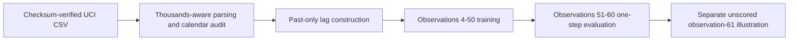

# Project 3: folder structure and copyable source files

These files are already created. Each hand-authored file appears below in a separate code block. The small original UCI CSV is bundled under data/; main.py can download and validate it if absent. Generated CSVs, JSON and figures are recreated by running main.py. No other project folder is needed.

```text
projects/03-logistics-demand-forecasting/
  main.py
  test_forecasting.py
  requirements.txt
  .gitignore
  .gitattributes
  README.md
  PROJECT_FILES.md
  data/
    Daily_Demand_Forecasting_Orders.csv  (unaltered public source, bundled)
    SOURCE.md
    cleaned_demand.csv
  outputs/
    metrics.json
    source_audit.json
    lagged_features.csv
    holdout_predictions.csv
    model_comparison.csv
    coefficients.csv
    next_observation_forecasts.csv
    forecast_comparison.png
    mae_comparison.png
    verification.md
```

## main.py

```python
"""Leakage-aware one-step forecasting of public UCI logistics observations."""

from hashlib import sha256
from io import BytesIO
import json
from pathlib import Path
import time
from urllib.request import urlopen
from zipfile import ZipFile

import numpy as np
import pandas as pd
from sklearn.linear_model import LinearRegression
from sklearn.metrics import mean_absolute_error, root_mean_squared_error

ROOT = Path(__file__).resolve().parent
SOURCE_NAME = "Daily_Demand_Forecasting_Orders.csv"
SOURCE_URL = "https://archive.ics.uci.edu/static/public/409/daily%2Bdemand%2Bforecasting%2Borders.zip"
SOURCE_SHA256 = "adf8dda021beae76b13b1cbb5b3c075d064f03b3353a711c1ddc357c6f89e924"
FEATURES = ["lag_1", "lag_2", "lag_3"]
TRAIN_END = 50


def load_source(path=None):
    """Use the bundled 5 KB CSV; download the original only when it is absent."""
    path = Path(path) if path is not None else ROOT / "data" / SOURCE_NAME
    if not path.exists():
        with urlopen(SOURCE_URL, timeout=30) as response:
            with ZipFile(BytesIO(response.read())) as archive:
                data = archive.read(SOURCE_NAME)
        if sha256(data).hexdigest() != SOURCE_SHA256:
            raise ValueError("Downloaded source differs from the audited version; review before use.")
        path.parent.mkdir(parents=True, exist_ok=True)
        path.write_bytes(data)
    if sha256(path.read_bytes()).hexdigest() != SOURCE_SHA256:
        raise ValueError("Source checksum mismatch. Use the unmodified UCI CSV.")
    # Periods are thousands separators: 539.577 means 539577, not 539.577.
    raw = pd.read_csv(path, sep=";", thousands=".")
    if raw.shape != (60, 13) or raw.isna().any().any():
        raise ValueError("Expected 60 complete observations with 13 source columns.")
    if not all(pd.api.types.is_integer_dtype(raw[column]) for column in raw.columns):
        raise ValueError("Source values must parse as integer counts/calendar codes.")
    data = raw.iloc[:, [0, 1, 12]].copy()
    data.columns = ["week_of_month", "day_of_week_code", "total_orders"]
    data.insert(0, "observation", range(1, len(data) + 1))
    if (data["total_orders"] <= 0).any() or not data["day_of_week_code"].between(2, 6).all():
        raise ValueError("Unexpected target values or weekday codes.")
    if not data["week_of_month"].between(1, 5).all():
        raise ValueError("Unexpected week-of-month code.")
    return raw, data


def audit_source(raw, data):
    """Record evidence about units, target leakage and limited date information."""
    expected_next = data["day_of_week_code"].shift(1).map({2: 3, 3: 4, 4: 5, 5: 6, 6: 2})
    breaks = data.loc[expected_next.notna() & (data["day_of_week_code"] != expected_next)]
    return {
        "source_url": SOURCE_URL, "csv_sha256": SOURCE_SHA256, "rows": len(data),
        "license": "CC BY 4.0", "doi": "https://doi.org/10.24432/C5BC8T",
        "periods_are_thousands_separators": True,
        "target_equals_type_A_plus_B_plus_C": bool((raw.iloc[:, 4:7].sum(axis=1) == data["total_orders"]).all()),
        "target_equals_nonurgent_plus_urgent_plus_fiscal": bool((raw.iloc[:, [2, 3, 7]].sum(axis=1) == data["total_orders"]).all()),
        "weekday_cycle_breaks_at_observations": breaks["observation"].tolist(),
        "week_field_decreases_at_observations": data.loc[data["week_of_month"].diff() < 0, "observation"].tolist(),
        "ordering_note": "UCI labels this time-series data. File order is preserved, but there are no dates "
                         "and two weekday-cycle breaks; consecutive business-day chronology is not verified. "
                         "All horizons are next observation under the source-order assumption.",
    }


def make_features(data):
    """Shift BEFORE using the rolling window: no current-target value is a feature."""
    frame = data[["observation", "total_orders"]].copy()
    for lag in [1, 2, 3]:
        frame[f"lag_{lag}"] = frame["total_orders"].shift(lag)
    frame["trailing_mean_3"] = frame["total_orders"].shift(1).rolling(3).mean()
    return frame.dropna().reset_index(drop=True)


def evaluate(frame, train_end=TRAIN_END):
    """Fit once through observation 50; score rolling one-step inputs for 51-60."""
    train = frame[frame["observation"] <= train_end]
    test = frame[frame["observation"] > train_end]
    if train.empty or test.empty:
        raise ValueError("Training and holdout sets must both contain observations.")
    model = LinearRegression()
    model.fit(train[FEATURES], train["total_orders"])
    predictions = test[["observation", "total_orders"]].rename(columns={"total_orders": "actual"}).copy()
    predictions["last_observation"] = test["lag_1"].to_numpy()
    predictions["trailing_mean_3"] = test["trailing_mean_3"].to_numpy()
    # Forecasts are counts; apply the same fixed zero floor to regression outputs.
    predictions["linear_regression"] = np.maximum(model.predict(test[FEATURES]), 0)
    scores = []
    for name in ["last_observation", "trailing_mean_3", "linear_regression"]:
        scores.append({"method": name,
                       "mae_orders": float(mean_absolute_error(predictions["actual"], predictions[name])),
                       "rmse_orders": float(root_mean_squared_error(predictions["actual"], predictions[name]))})
    scores = pd.DataFrame(scores).sort_values("mae_orders").reset_index(drop=True)
    return model, predictions.reset_index(drop=True), scores


def next_observation_forecasts(data, frame):
    """After evaluation, refit on all available labels for an unscored illustration."""
    model = LinearRegression().fit(frame[FEATURES], frame["total_orders"])
    recent = data["total_orders"].iloc[-3:]
    row = pd.DataFrame([[recent.iloc[-1], recent.iloc[-2], recent.iloc[-3]]], columns=FEATURES)
    return pd.DataFrame([
        {"observation": len(data) + 1, "method": "last_observation", "predicted_orders": float(recent.iloc[-1])},
        {"observation": len(data) + 1, "method": "trailing_mean_3", "predicted_orders": float(recent.mean())},
        {"observation": len(data) + 1, "method": "linear_regression", "predicted_orders": float(max(model.predict(row)[0], 0))},
    ])


def save_charts(data, predictions, scores, output):
    import matplotlib
    matplotlib.use("Agg")
    import matplotlib.pyplot as plt
    from matplotlib.ticker import StrMethodFormatter

    colors = {"last_observation": "#778899", "trailing_mean_3": "#D97732", "linear_regression": "#007F78"}
    fig, axes = plt.subplots(2, 1, figsize=(11, 7), layout="constrained")
    axes[0].plot(data["observation"], data["total_orders"], color="#142D3D", label="Actual orders")
    axes[0].axvline(TRAIN_END + 0.5, color="#D97732", linestyle="--", label="Holdout begins")
    axes[0].set(title="History: 60 observations in original source order", ylabel="Orders")
    axes[0].legend(loc="upper right")
    axes[1].plot(predictions["observation"], predictions["actual"], color="#142D3D", marker="o", label="Actual")
    for method, color in colors.items():
        axes[1].plot(predictions["observation"], predictions[method], color=color, marker=".", label=method)
    axes[1].set(title="Final 10 observations: one-step forecasts, not a 10-step forecast",
                xlabel="Source observation (no calendar date provided)", ylabel="Orders")
    axes[1].legend(fontsize=8, ncol=2)
    for axis in axes:
        axis.yaxis.set_major_formatter(StrMethodFormatter("{x:,.0f}"))
        axis.spines[["top", "right"]].set_visible(False)
    fig.savefig(output / "forecast_comparison.png", dpi=160)
    plt.close(fig)
    fig, axis = plt.subplots(figsize=(8, 4), layout="constrained")
    axis.barh(scores["method"], scores["mae_orders"], color=[colors[name] for name in scores["method"]])
    axis.invert_yaxis()
    axis.set(title="Holdout MAE: lower is better (10 observations)", xlabel="Mean absolute error (orders)")
    fig.savefig(output / "mae_comparison.png", dpi=160)
    plt.close(fig)


def main():
    start = time.perf_counter()
    output = ROOT / "outputs"
    output.mkdir(exist_ok=True)
    raw, data = load_source()
    audit = audit_source(raw, data)
    frame = make_features(data)
    model, predictions, scores = evaluate(frame)
    forecasts = next_observation_forecasts(data, frame)
    data.to_csv(ROOT / "data" / "cleaned_demand.csv", index=False)
    frame.to_csv(output / "lagged_features.csv", index=False)
    predictions.to_csv(output / "holdout_predictions.csv", index=False)
    scores.to_csv(output / "model_comparison.csv", index=False)
    forecasts.to_csv(output / "next_observation_forecasts.csv", index=False)
    pd.DataFrame({"feature": FEATURES, "coefficient": model.coef_}).to_csv(output / "coefficients.csv", index=False)
    (output / "source_audit.json").write_text(json.dumps(audit, indent=2) + "\n", encoding="utf-8")
    save_charts(data, predictions, scores, output)
    summary = {
        "source_observations": len(data), "first_training_target_observation": 4,
        "last_training_target_observation": TRAIN_END, "training_examples": int((frame["observation"] <= TRAIN_END).sum()),
        "holdout_examples": len(predictions), "holdout_observations": predictions["observation"].tolist(),
        "features": FEATURES, "scores": scores.to_dict(orient="records"),
        "holdout_lowest_mae_method": scores.iloc[0]["method"],
        "holdout_model_intercept": float(model.intercept_),
        "weekday_cycle_breaks": audit["weekday_cycle_breaks_at_observations"],
        "evaluation": "Fixed training fit; sequential one-step inputs use only already observed prior totals. "
                      "Source order assumed, exact dates unverified. No hyperparameter tuning; "
                      "lowest-error comparison is descriptive, not deployment selection.",
        "run_seconds": round(time.perf_counter() - start, 3),
    }
    (output / "metrics.json").write_text(json.dumps(summary, indent=2) + "\n", encoding="utf-8")
    print(scores.to_string(index=False))
    print(f"\nTraining examples: {summary['training_examples']}; holdout: {len(predictions)}")
    print("Lowest observed holdout MAE:", summary["holdout_lowest_mae_method"])
    print("Source weekday-cycle breaks:", audit["weekday_cycle_breaks_at_observations"])
    print("Next-observation forecasts (unscored illustration):\n", forecasts.to_string(index=False))


if __name__ == "__main__":
    main()
```

## test_forecasting.py

```python
"""Checks source parsing, past-only features, the split and independently scored errors."""
from pathlib import Path
import tempfile
import unittest

import numpy as np
import pandas as pd

from main import FEATURES, audit_source, evaluate, load_source, make_features, next_observation_forecasts


class ForecastChecks(unittest.TestCase):
    def test_source_units_and_calendar_limits(self):
        raw, data = load_source()
        self.assertEqual(data.iloc[0]["total_orders"], 539577)
        self.assertEqual(data.iloc[5]["total_orders"], 207364)
        audit = audit_source(raw, data)
        self.assertTrue(audit["target_equals_type_A_plus_B_plus_C"])
        self.assertTrue(audit["target_equals_nonurgent_plus_urgent_plus_fiscal"])
        self.assertEqual(audit["weekday_cycle_breaks_at_observations"], [33, 40])

    def test_checksum_rejects_modified_source(self):
        with tempfile.TemporaryDirectory() as folder:
            path = Path(folder) / "changed.csv"
            path.write_text("modified input", encoding="utf-8")
            with self.assertRaisesRegex(ValueError, "checksum"):
                load_source(path)

    def test_lags_and_average_are_shifted(self):
        data = pd.DataFrame({"observation": range(1, 7), "total_orders": [10, 20, 30, 40, 50, 60]})
        frame = make_features(data)
        self.assertEqual(frame.iloc[0][FEATURES].tolist(), [30, 20, 10])
        self.assertEqual(frame.iloc[0]["trailing_mean_3"], 20)
        self.assertEqual(frame.iloc[0]["total_orders"], 40)

    def test_current_and_future_targets_cannot_change_current_features(self):
        _, data = load_source()
        original = make_features(data)
        changed = data.copy()
        changed.loc[changed["observation"] >= 51, "total_orders"] += 999999
        altered = make_features(changed)
        np.testing.assert_array_equal(original.loc[original["observation"] == 51, FEATURES],
                                      altered.loc[altered["observation"] == 51, FEATURES])
        first_model, first_predictions, _ = evaluate(original)
        changed_model, changed_predictions, _ = evaluate(altered)
        np.testing.assert_allclose(first_model.coef_, changed_model.coef_)
        self.assertAlmostEqual(first_predictions.iloc[0]["linear_regression"],
                               changed_predictions.iloc[0]["linear_regression"])

    def test_holdout_and_metrics_match_independent_calculation(self):
        _, data = load_source()
        frame = make_features(data)
        _, predictions, scores = evaluate(frame)
        self.assertEqual(len(frame[frame["observation"] <= 50]), 47)
        self.assertEqual(predictions["observation"].tolist(), list(range(51, 61)))
        self.assertEqual(set(scores["method"]), {"last_observation", "trailing_mean_3", "linear_regression"})
        for method in scores["method"]:
            error = predictions["actual"].to_numpy() - predictions[method].to_numpy()
            row = scores[scores["method"] == method].iloc[0]
            self.assertAlmostEqual(row["mae_orders"], np.abs(error).mean())
            self.assertAlmostEqual(row["rmse_orders"], np.sqrt(np.mean(error ** 2)))

    def test_next_observation_is_unscored_and_uses_latest_values(self):
        _, data = load_source()
        forecasts = next_observation_forecasts(data, make_features(data)).set_index("method")
        self.assertTrue((forecasts["observation"] == 61).all())
        self.assertEqual(forecasts.loc["last_observation", "predicted_orders"], data.iloc[-1]["total_orders"])
        self.assertEqual(forecasts.loc["trailing_mean_3", "predicted_orders"], data["total_orders"].tail(3).mean())
        self.assertTrue((forecasts["predicted_orders"] >= 0).all())


if __name__ == "__main__":
    unittest.main()
```

## requirements.txt

```text
numpy==2.5.4
pandas==3.1.0
scikit-learn==1.9.1
matplotlib==3.11.2
```

## .gitignore

```text
.venv/
__pycache__/
*.py[cod]
.pytest_cache/
.env
.env.*
!.env.example
*.log
```

## .gitattributes

```text
# Preserve the exact UCI source bytes for the audited SHA-256 on every platform.
data/Daily_Demand_Forecasting_Orders.csv -text
```

## data/SOURCE.md

````markdown
# Dataset source and reuse

- **Dataset:** Daily Demand Forecasting Orders, UCI Machine Learning Repository, dataset 409.
- **Source page:** https://archive.ics.uci.edu/dataset/409/daily+demand+forecasting+orders
- **Direct no-login download:** https://archive.ics.uci.edu/static/public/409/daily%2Bdemand%2Bforecasting%2Borders.zip
- **Attribution:** Ferreira, R., Martiniano, A., Ferreira, A., Ferreira, A., & Sassi, R. (2016). Daily Demand Forecasting Orders [Dataset]. UCI Machine Learning Repository. https://doi.org/10.24432/C5BC8T
- **License:** Creative Commons Attribution 4.0 International, https://creativecommons.org/licenses/by/4.0/
- **Original file:** Daily_Demand_Forecasting_Orders.csv; source bytes are unchanged. The bundled file permits offline execution. A missing original can be downloaded automatically; a changed checksum causes an explicit error.
- **Original SHA-256:** `adf8dda021beae76b13b1cbb5b3c075d064f03b3353a711c1ddc357c6f89e924`

UCI describes this as real data from a Brazilian logistics company, collected over 60 days, and labels it time-series data. The CSV has 60 observations and 13 columns but no year, month identifier or exact dates. We preserve its row order as an explicit sequence assumption; this does not independently verify calendar chronology.

## Transformations and audit observations

- Read the semicolon-separated file with periods interpreted as thousands separators. `539.577` becomes 539577 orders. This interpretation is supported by integer metadata and exact component-sum checks across all 60 rows.
- Target totals exactly equal both A+B+C order-type counts and non-urgent+urgent+fiscal counts. These same-period components are not used as forecasting inputs.
- The source weekday codes are 2=Monday through 6=Friday. Transitions before observations 33 and 40 break the consecutive Monday-Friday cycle. We do not invent dates, impute missing observations, sort by repeating calendar fields or label lag 5 as an assured same-weekday value.
- Week-of-month decreases at observations 20 and 40, consistent with resets but insufficient to assign actual months/years.
- `cleaned_demand.csv` retains the target and two calendar-code columns with descriptive names and adds a one-based source observation ID. Calendar fields remain audit context only.
- `outputs/lagged_features.csv` adds three strictly historical lags and a shifted three-observation mean; these are project transformations, not source columns.

No synthetic values, fabricated dates, interpolated observations or randomized row splits are introduced.
````

## README.md

````markdown
# Logistics Demand Forecasting

A source-sequence forecasting experiment comparing persistence, a trailing mean and lag-based linear regression, with explicit information boundaries and a final ten-observation evaluation window.

> Time boundary: the source has no exact calendar dates. Lag distances are observation offsets, and the recorded evaluation consists of sequential one-step forecasts.

## Contents

- [Overview](#overview)
- [Dataset and data contract](#dataset-and-data-contract)
- [Architecture and components](#architecture-and-components)
- [Processing pipeline](#processing-pipeline)
- [Configuration and metric definitions](#configuration-and-metric-definitions)
- [Recorded results and evidence](#recorded-results-and-evidence)
- [Interpretation and operational use](#interpretation-and-operational-use)
- [Running locally](#running-locally)
- [Validation and reproducibility](#validation-and-reproducibility)
- [Project structure](#project-structure)
- [Technology stack](#technology-stack)
- [Limitations and next steps](#limitations-and-next-steps)
- [Further technical documentation](#further-technical-documentation)

## Overview

Can historical workload totals improve a forecast for the **next observed reporting period**, under the dataset's source-order assumption?

**Calendar boundary:** the source has no actual dates and contains two weekday-cycle breaks. This is a one-step source-sequence forecasting demonstration, not a verified forecast for a particular next business date. No dates are invented.

## Dataset and data contract

- **Public source:** [UCI Daily Demand Forecasting Orders](https://archive.ics.uci.edu/dataset/409/daily+demand+forecasting+orders), real logistics-company data as described by UCI; **60 observations and 13 original columns**.
- **Attribution:** Ferreira, R., Martiniano, A., Ferreira, A., Ferreira, A., & Sassi, R. (2016). Daily Demand Forecasting Orders [Dataset]. UCI Machine Learning Repository. [DOI: 10.24432/C5BC8T](https://doi.org/10.24432/C5BC8T).
- **License:** [CC BY 4.0](https://creativecommons.org/licenses/by/4.0/). Source and transformation details: [data/SOURCE.md](data/SOURCE.md).
- **Files:** unmodified [original CSV](data/Daily_Demand_Forecasting_Orders.csv) and generated [cleaned CSV](data/cleaned_demand.csv). The small original is bundled, so normal runs need no data download or login.
- **Units:** read periods as thousands separators: the first target `539.577` becomes **539,577 orders**. Both component-sum checks agree for every row under this parsing. Do not treat these values as fractional orders.
- **Reproducibility:** fixed input checksum, deterministic regression and source-order split; no random generation or splitting is used, so a random seed is unnecessary.

| Field | Meaning and use |
|---|---|
| observation | One-based original row number, 1-60; added by this project, not a date |
| week_of_month | Source code 1-5; retained for audit, not a model feature |
| day_of_week_code | Source code 2=Monday through 6=Friday; retained for audit only |
| total_orders | Target count for the observed reporting period |
| lag_1 / lag_2 / lag_3 | Target totals one, two and three source observations earlier |
| trailing_mean_3 | Mean of the prior three totals; excludes the current target |

The unused source columns cover same-period non-urgent/urgent, order types, fiscal, traffic-controller and banking counts. Both **A+B+C** and **non-urgent+urgent+fiscal** exactly reconstruct the target across all 60 observations. Using these to claim an advance forecast would leak the answer.

The week fields reset before observations 20 and 40; weekday transitions before 33 and 40 do not follow the consecutive workday cycle. UCI's time-series label supports preserving source order, but exact dates and consecutive collection intervals cannot be independently verified from these fields. [source_audit.json](outputs/source_audit.json) records the checks.

## Architecture and components



| Component | Entry points or assets | Responsibility |
|---|---|---|
| [main.py](main.py) | load_source / audit_source | Verify source bytes, integer parsing, reconstructed totals and weekday/period anomalies. |
| [main.py](main.py) | make_features | Build shifted lag counts and a past-only three-observation mean. |
| [main.py](main.py) | evaluate | Fit one regression and score all methods on identical final-ten targets. |
| [main.py](main.py) | next_observation_forecasts | Refit separately for an unscored next-observation illustration. |
| [test_forecasting.py](test_forecasting.py) | Automated checks | Perturb future targets to verify the current-feature boundary and independently recompute errors. |

## Processing pipeline

1. Verify the original CSV's SHA-256, parse integer counts correctly and check its shape, missingness and calendar codes.
2. Preserve file order. Add observation IDs rather than fabricated dates or a sort by repeating week/weekday labels.
3. Shift the target by 1, 2 and 3 observations; calculate the moving mean after shifting. Drop only the first three rows, which lack enough history.
4. Fit linear regression once on target observations **4-50**, giving **47 supervised training examples**. Earlier observations 1-3 supply lag history. Reserve observations **51-60** as the ten-example holdout.
5. Compare the last observed total, a trailing three-observation mean and the fixed regression model using identical holdout targets. Apply a fixed zero floor to regression predictions because order counts cannot be negative; retain decimal forecasts for scoring.
6. Report MAE and RMSE, save predictions/features/coefficients and draw comparison charts. Do not tune against the holdout or hide a baseline that performs better.
7. Separately refit regression on all 57 supervised examples and show an **unscored illustration** for observation 61 alongside both baselines. This refit does not change the holdout results.

**Evaluation timing:** the model coefficients stay fixed during evaluation, but each one-step prediction uses actual totals already observed at that point. After observing 51, it can be used to forecast 52. This is **ten sequential one-step forecasts**, not ten forecasts all issued at observation 50. Computing shifted columns in one batch is equivalent to that information boundary; a test confirms that changing current/future targets cannot alter the current forecast or training fit.

The regression uses only three lag counts, plus a fitted intercept. No same-period components or future target values are inputs. The [scikit-learn lagged-feature example](https://scikit-learn.org/stable/auto_examples/applications/plot_time_series_lagged_features.html) provides related technical context on time-aware evaluation.

## Configuration and metric definitions

| Setting or measure | Definition |
|---|---|
| Source parsing | Semicolon delimiter; periods interpreted as thousands separators |
| Regression inputs | `lag_1`, `lag_2`, `lag_3`, plus fitted intercept |
| Training examples | Target observations 4-50; the first three rows provide lag history |
| Holdout | Target observations 51-60, without shuffling |
| Persistence baseline | Previous observed total |
| Mean baseline | Mean of the previous three observed totals |
| MAE | `mean(abs(actual - prediction))`, in orders |
| RMSE | `sqrt(mean((actual - prediction)^2))`, in orders |
| Nonnegative prediction rule | Regression forecasts receive a fixed zero floor before scoring |

During holdout evaluation, fitted coefficients remain fixed but newly observed actual totals become valid history for the next prediction. Same-period component counts are excluded because they reconstruct the target. The observation-61 illustration has no actual value and cannot contribute an accuracy score.

## Recorded results and evidence

These values were computed by running the project. Errors are in **orders per forecast**; lower is better.

| Method | Holdout MAE | Holdout RMSE |
|---|---:|---:|
| Last-observation baseline | **44,572.30** | **56,989.24** |
| Lag-based linear regression | 46,172.71 | 59,811.13 |
| Trailing three-observation mean | 50,305.50 | 61,185.46 |

**Regression did not beat the last-observation baseline on this holdout.** The lowest observed MAE is descriptive evidence from only ten targets; it is not a production model-selection result or a guarantee of future performance. There was no hyperparameter search.


| Method | Observation 61 forecast: illustration only |
|---|---:|
| Last observation | 331,900.00 |
| Trailing mean of three | 313,432.33 |
| Regression refitted on all observed data | 304,614.05 |

No actual total or calendar date is available for observation 61, so these forecasts have **no computed accuracy**. The spread between them is not a statistical prediction interval.

Evidence files: [metrics](outputs/metrics.json), [method comparison](outputs/model_comparison.csv), [holdout predictions](outputs/holdout_predictions.csv), [lagged features](outputs/lagged_features.csv), [holdout-fit coefficients](outputs/coefficients.csv), [illustrative next forecasts](outputs/next_observation_forecasts.csv), [source audit](outputs/source_audit.json) and [verification record](outputs/verification.md).

Six automated checks passed. They cover integer parsing, calendar limits, checksum rejection, shifted features, future-target perturbation, the training boundary, independent MAE/RMSE arithmetic and the illustrative next-observation inputs.

## Interpretation and operational use

- **Keep the simple baseline as a benchmark:** last observation achieved 44,572.30 MAE versus 46,172.71 for regression. The extra model complexity did not improve this small test; compare again on genuinely new data before preferring a method operationally.
- **Treat forecasts as provisional workload estimates:** even the lowest-MAE method has substantial error. Obtain more timestamped history before capacity commitments; converting order counts to staffing also requires throughput, shift and service-level information that this file does not contain.
- **Prioritize data quality and timing:** correct thousands parsing, exclude same-day components and request exact dates plus an explanation of the two weekday gaps. These are prerequisites for assessing calendar seasonality and true next-workday forecasts. No inventory purchase quantity or savings is inferred.

## Running locally

Prerequisite: **Python 3.12+** and a terminal; verified with Python 3.12. No GPU, paid API or cloud account is required. From the repository root, run these three commands in your Python environment:

```powershell
cd projects/03-logistics-demand-forecasting
python -m pip install -r requirements.txt
python main.py
```

The script prints the measured comparison and saves artifacts in `outputs/`. The bundled original allows offline data access. If the original is missing, the script downloads the small official archive automatically, verifies the checksum and preserves its original bytes. Changed/corrupted input fails explicitly rather than silently substituting data. `.gitattributes` prevents Git from changing the original source's line endings on another machine.

Optional verification, separate from launching: `python -m unittest -v`. Runs recreate outputs, including a newly measured runtime; there is no dashboard server or stored model required.

## Validation and reproducibility

The automated suite contains **6 tests**. It checks the following implementation boundaries:

Test implementation: [test_forecasting.py](test_forecasting.py).

- Source units and calendar limits.
- Checksum rejects modified source.
- Lags and average are shifted.
- Current and future targets cannot change current features.
- Holdout and metrics match independent calculation.
- Next observation is unscored and uses latest values.

From the project directory, run:

```powershell
python -m unittest -v
```

Recorded execution and any browser-review evidence is retained in [outputs/verification.md](outputs/verification.md). Reported figures correspond to saved execution artifacts; running a report generator can overwrite its generated outputs. Package requirements, source checksums and fixed parameters define the reproducibility boundary; elapsed times and some model/solver outputs can vary across environments.

## Project structure

```text
03-logistics-demand-forecasting/
  main.py
  PROJECT_FILES.md
  README.md
  requirements.txt
  test_forecasting.py
  data/
    Bundled inputs, provenance and prepared data
  outputs/
    Recorded metrics, audit files, tables and figures
```

Generated environments, database files, model artifacts and compiled assets follow the project's [.gitignore](.gitignore). The [copyable source bundle](PROJECT_FILES.md) mirrors the README and contains individual file blocks.

## Technology stack

Python, NumPy, pandas, scikit-learn LinearRegression and error metrics, matplotlib, plus standard-library hashlib/urllib/zipfile/unittest. Direct dependencies are pinned in [requirements.txt](requirements.txt). Regression and baselines are deterministic; no randomized seed, paid service or hosted infrastructure is involved.

## Limitations and next steps

- Only 60 observations and ten holdout targets: there is no robust claim about generalization, calibrated uncertainty or long-term seasonality.
- Original row order is assumed to be a meaningful collection sequence. No exact dates/month identifiers exist, and two weekday transitions break a consecutive workday cycle. The audit cannot certify exact chronology; a true dated forecast needs better source metadata.
- Lag distances are observation offsets, not guaranteed day offsets. Gaps are neither filled nor imputed. There is no calendar-dated, seven-day or multi-step forecast.
- The fixed model uses previous observed holdout outcomes as they become available. A forecast for ten periods issued all at once would need a different evaluation and would not have these results.
- Last-observation, trailing-three and three-lag regression choices are fixed in advance. The lowest error on this one holdout must not be treated as a deployment decision; further validation needs more data.
- The zero floor prevents negative count predictions; forecasts remain fractional expected counts and are not rounded before scoring.
- The next-observation illustration is unscored, not a measured operational outcome. No staffing reductions, revenue improvements, stock quantities or cost savings were measured.
- There is no live ingestion, retraining service, seasonal model or prediction interval. Improvements should start with dated history and rolling validation within training data before a fresh final test.

## Further technical documentation

- [Dataset attribution, licensing and source transformations](data/SOURCE.md)
- [Pinned Python dependencies](requirements.txt)
- [Recorded execution and verification evidence](outputs/verification.md)
- [Folder structure and individually copyable source files](PROJECT_FILES.md)

[Back to contents](#contents)
````
