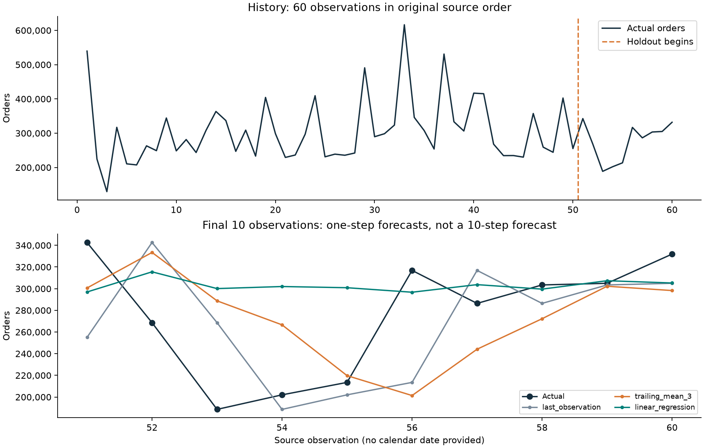
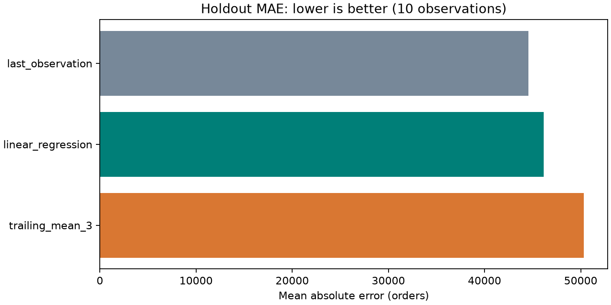

# Logistics Demand Forecasting

A source-sequence forecasting experiment comparing persistence, a trailing mean and lag-based linear regression, with explicit information boundaries and a final ten-observation evaluation window.

> Time boundary: the source has no exact calendar dates. Lag distances are observation offsets, and the recorded evaluation consists of sequential one-step forecasts.

## Contents

- [Overview](#overview)
- [Dataset and data contract](#dataset-and-data-contract)
- [Architecture and components](#architecture-and-components)
- [Processing pipeline](#processing-pipeline)
- [Configuration and metric definitions](#configuration-and-metric-definitions)
- [Recorded results and evidence](#recorded-results-and-evidence)
- [Interpretation and operational use](#interpretation-and-operational-use)
- [Running locally](#running-locally)
- [Validation and reproducibility](#validation-and-reproducibility)
- [Project structure](#project-structure)
- [Technology stack](#technology-stack)
- [Limitations and next steps](#limitations-and-next-steps)
- [Further technical documentation](#further-technical-documentation)

## Overview

Can historical workload totals improve a forecast for the **next observed reporting period**, under the dataset's source-order assumption?

**Calendar boundary:** the source has no actual dates and contains two weekday-cycle breaks. This is a one-step source-sequence forecasting demonstration, not a verified forecast for a particular next business date. No dates are invented.

## Dataset and data contract

- **Public source:** [UCI Daily Demand Forecasting Orders](https://archive.ics.uci.edu/dataset/409/daily+demand+forecasting+orders), real logistics-company data as described by UCI; **60 observations and 13 original columns**.
- **Attribution:** Ferreira, R., Martiniano, A., Ferreira, A., Ferreira, A., & Sassi, R. (2016). Daily Demand Forecasting Orders [Dataset]. UCI Machine Learning Repository. [DOI: 10.24432/C5BC8T](https://doi.org/10.24432/C5BC8T).
- **License:** [CC BY 4.0](https://creativecommons.org/licenses/by/4.0/). Source and transformation details: [data/SOURCE.md](data/SOURCE.md).
- **Files:** unmodified [original CSV](data/Daily_Demand_Forecasting_Orders.csv) and generated [cleaned CSV](data/cleaned_demand.csv). The small original is bundled, so normal runs need no data download or login.
- **Units:** read periods as thousands separators: the first target `539.577` becomes **539,577 orders**. Both component-sum checks agree for every row under this parsing. Do not treat these values as fractional orders.
- **Reproducibility:** fixed input checksum, deterministic regression and source-order split; no random generation or splitting is used, so a random seed is unnecessary.

| Field | Meaning and use |
|---|---|
| observation | One-based original row number, 1-60; added by this project, not a date |
| week_of_month | Source code 1-5; retained for audit, not a model feature |
| day_of_week_code | Source code 2=Monday through 6=Friday; retained for audit only |
| total_orders | Target count for the observed reporting period |
| lag_1 / lag_2 / lag_3 | Target totals one, two and three source observations earlier |
| trailing_mean_3 | Mean of the prior three totals; excludes the current target |

The unused source columns cover same-period non-urgent/urgent, order types, fiscal, traffic-controller and banking counts. Both **A+B+C** and **non-urgent+urgent+fiscal** exactly reconstruct the target across all 60 observations. Using these to claim an advance forecast would leak the answer.

The week fields reset before observations 20 and 40; weekday transitions before 33 and 40 do not follow the consecutive workday cycle. UCI's time-series label supports preserving source order, but exact dates and consecutive collection intervals cannot be independently verified from these fields. [source_audit.json](outputs/source_audit.json) records the checks.

## Architecture and components


| Component | Entry points or assets | Responsibility |
|---|---|---|
| [main.py](main.py) | load_source / audit_source | Verify source bytes, integer parsing, reconstructed totals and weekday/period anomalies. |
| [main.py](main.py) | make_features | Build shifted lag counts and a past-only three-observation mean. |
| [main.py](main.py) | evaluate | Fit one regression and score all methods on identical final-ten targets. |
| [main.py](main.py) | next_observation_forecasts | Refit separately for an unscored next-observation illustration. |
| [test_forecasting.py](test_forecasting.py) | Automated checks | Perturb future targets to verify the current-feature boundary and independently recompute errors. |

## Processing pipeline

1. Verify the original CSV's SHA-256, parse integer counts correctly and check its shape, missingness and calendar codes.
2. Preserve file order. Add observation IDs rather than fabricated dates or a sort by repeating week/weekday labels.
3. Shift the target by 1, 2 and 3 observations; calculate the moving mean after shifting. Drop only the first three rows, which lack enough history.
4. Fit linear regression once on target observations **4-50**, giving **47 supervised training examples**. Earlier observations 1-3 supply lag history. Reserve observations **51-60** as the ten-example holdout.
5. Compare the last observed total, a trailing three-observation mean and the fixed regression model using identical holdout targets. Apply a fixed zero floor to regression predictions because order counts cannot be negative; retain decimal forecasts for scoring.
6. Report MAE and RMSE, save predictions/features/coefficients and draw comparison charts. Do not tune against the holdout or hide a baseline that performs better.
7. Separately refit regression on all 57 supervised examples and show an **unscored illustration** for observation 61 alongside both baselines. This refit does not change the holdout results.

**Evaluation timing:** the model coefficients stay fixed during evaluation, but each one-step prediction uses actual totals already observed at that point. After observing 51, it can be used to forecast 52. This is **ten sequential one-step forecasts**, not ten forecasts all issued at observation 50. Computing shifted columns in one batch is equivalent to that information boundary; a test confirms that changing current/future targets cannot alter the current forecast or training fit.

The regression uses only three lag counts, plus a fitted intercept. No same-period components or future target values are inputs. The [scikit-learn lagged-feature example](https://scikit-learn.org/stable/auto_examples/applications/plot_time_series_lagged_features.html) provides related technical context on time-aware evaluation.

## Configuration and metric definitions

| Setting or measure | Definition |
|---|---|
| Source parsing | Semicolon delimiter; periods interpreted as thousands separators |
| Regression inputs | `lag_1`, `lag_2`, `lag_3`, plus fitted intercept |
| Training examples | Target observations 4-50; the first three rows provide lag history |
| Holdout | Target observations 51-60, without shuffling |
| Persistence baseline | Previous observed total |
| Mean baseline | Mean of the previous three observed totals |
| MAE | `mean(abs(actual - prediction))`, in orders |
| RMSE | `sqrt(mean((actual - prediction)^2))`, in orders |
| Nonnegative prediction rule | Regression forecasts receive a fixed zero floor before scoring |

During holdout evaluation, fitted coefficients remain fixed but newly observed actual totals become valid history for the next prediction. Same-period component counts are excluded because they reconstruct the target. The observation-61 illustration has no actual value and cannot contribute an accuracy score.

## Recorded results and evidence

These values were computed by running the project. Errors are in **orders per forecast**; lower is better.

| Method | Holdout MAE | Holdout RMSE |
|---|---:|---:|
| Last-observation baseline | **44,572.30** | **56,989.24** |
| Lag-based linear regression | 46,172.71 | 59,811.13 |
| Trailing three-observation mean | 50,305.50 | 61,185.46 |

**Regression did not beat the last-observation baseline on this holdout.** The lowest observed MAE is descriptive evidence from only ten targets; it is not a production model-selection result or a guarantee of future performance. There was no hyperparameter search.





| Method | Observation 61 forecast: illustration only |
|---|---:|
| Last observation | 331,900.00 |
| Trailing mean of three | 313,432.33 |
| Regression refitted on all observed data | 304,614.05 |

No actual total or calendar date is available for observation 61, so these forecasts have **no computed accuracy**. The spread between them is not a statistical prediction interval.

Evidence files: [metrics](outputs/metrics.json), [method comparison](outputs/model_comparison.csv), [holdout predictions](outputs/holdout_predictions.csv), [lagged features](outputs/lagged_features.csv), [holdout-fit coefficients](outputs/coefficients.csv), [illustrative next forecasts](outputs/next_observation_forecasts.csv), [source audit](outputs/source_audit.json) and [verification record](outputs/verification.md).

Six automated checks passed. They cover integer parsing, calendar limits, checksum rejection, shifted features, future-target perturbation, the training boundary, independent MAE/RMSE arithmetic and the illustrative next-observation inputs.

## Interpretation and operational use

- **Keep the simple baseline as a benchmark:** last observation achieved 44,572.30 MAE versus 46,172.71 for regression. The extra model complexity did not improve this small test; compare again on genuinely new data before preferring a method operationally.
- **Treat forecasts as provisional workload estimates:** even the lowest-MAE method has substantial error. Obtain more timestamped history before capacity commitments; converting order counts to staffing also requires throughput, shift and service-level information that this file does not contain.
- **Prioritize data quality and timing:** correct thousands parsing, exclude same-day components and request exact dates plus an explanation of the two weekday gaps. These are prerequisites for assessing calendar seasonality and true next-workday forecasts. No inventory purchase quantity or savings is inferred.

## Running locally

Prerequisite: **Python 3.12+** and a terminal; verified with Python 3.12. No GPU, paid API or cloud account is required. From the repository root, run these three commands in your Python environment:

```powershell
cd projects/03-logistics-demand-forecasting
python -m pip install -r requirements.txt
python main.py
```

The script prints the measured comparison and saves artifacts in `outputs/`. The bundled original allows offline data access. If the original is missing, the script downloads the small official archive automatically, verifies the checksum and preserves its original bytes. Changed/corrupted input fails explicitly rather than silently substituting data. `.gitattributes` prevents Git from changing the original source's line endings on another machine.

Optional verification, separate from launching: `python -m unittest -v`. Runs recreate outputs, including a newly measured runtime; there is no dashboard server or stored model required.

## Validation and reproducibility

The automated suite contains **6 tests**. It checks the following implementation boundaries:

Test implementation: [test_forecasting.py](test_forecasting.py).

- Source units and calendar limits.
- Checksum rejects modified source.
- Lags and average are shifted.
- Current and future targets cannot change current features.
- Holdout and metrics match independent calculation.
- Next observation is unscored and uses latest values.

From the project directory, run:

```powershell
python -m unittest -v
```

Recorded execution and any browser-review evidence is retained in [outputs/verification.md](outputs/verification.md). Reported figures correspond to saved execution artifacts; running a report generator can overwrite its generated outputs. Package requirements, source checksums and fixed parameters define the reproducibility boundary; elapsed times and some model/solver outputs can vary across environments.

## Project structure

```text
03-logistics-demand-forecasting/
  main.py
  PROJECT_FILES.md
  README.md
  requirements.txt
  test_forecasting.py
  data/
    Bundled inputs, provenance and prepared data
  outputs/
    Recorded metrics, audit files, tables and figures
```

Generated environments, database files, model artifacts and compiled assets follow the project's [.gitignore](.gitignore). The [copyable source bundle](PROJECT_FILES.md) mirrors the README and contains individual file blocks.

## Technology stack

Python, NumPy, pandas, scikit-learn LinearRegression and error metrics, matplotlib, plus standard-library hashlib/urllib/zipfile/unittest. Direct dependencies are pinned in [requirements.txt](requirements.txt). Regression and baselines are deterministic; no randomized seed, paid service or hosted infrastructure is involved.

## Limitations and next steps

- Only 60 observations and ten holdout targets: there is no robust claim about generalization, calibrated uncertainty or long-term seasonality.
- Original row order is assumed to be a meaningful collection sequence. No exact dates/month identifiers exist, and two weekday transitions break a consecutive workday cycle. The audit cannot certify exact chronology; a true dated forecast needs better source metadata.
- Lag distances are observation offsets, not guaranteed day offsets. Gaps are neither filled nor imputed. There is no calendar-dated, seven-day or multi-step forecast.
- The fixed model uses previous observed holdout outcomes as they become available. A forecast for ten periods issued all at once would need a different evaluation and would not have these results.
- Last-observation, trailing-three and three-lag regression choices are fixed in advance. The lowest error on this one holdout must not be treated as a deployment decision; further validation needs more data.
- The zero floor prevents negative count predictions; forecasts remain fractional expected counts and are not rounded before scoring.
- The next-observation illustration is unscored, not a measured operational outcome. No staffing reductions, revenue improvements, stock quantities or cost savings were measured.
- There is no live ingestion, retraining service, seasonal model or prediction interval. Improvements should start with dated history and rolling validation within training data before a fresh final test.

## Further technical documentation

- [Dataset attribution, licensing and source transformations](data/SOURCE.md)
- [Pinned Python dependencies](requirements.txt)
- [Recorded execution and verification evidence](outputs/verification.md)
- [Folder structure and individually copyable source files](PROJECT_FILES.md)

[Back to contents](#contents)
